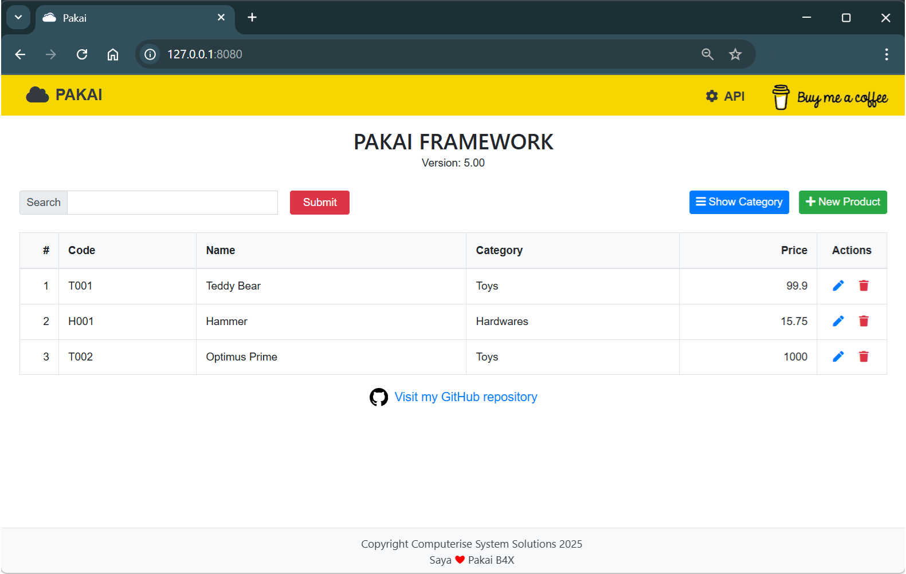

# Pakai Server — B4J Fullstack Web Application & API Framework

**Version:** 6.99 | **License:** MIT | **Author:** Poon Yip Hoon (Aeric)

Pakai Server is a full-stack B4J project template for building modern web applications and REST APIs. It generates **all HTML server-side** using B4X code (no client-side rendering), leverages **HTMX** for dynamic interactions without custom JavaScript, and includes both a **Web UI** and a **REST API** with auto-generated **OpenAPI 3.0** documentation and **Swagger UI**.

> **Forum thread:** [https://www.b4x.com/android/forum/threads/web-project-template-pakai-server-v6.169224/](https://www.b4x.com/android/forum/threads/web-project-template-pakai-server-v6.169224/)  
> **GitHub:** [https://github.com/pyhoon/pakai-server-b4j](https://github.com/pyhoon/pakai-server-b4j)
> **Tutorial:** [Pakai Framework v6.99 Tutorial](TUTORIAL.md)  
> **Libraries Guide:** [Dependency Libraries Guide](TUTORIAL-LIBRARIES.md)



---

## Features

- **Four project templates** — Full Stack, API-only, Web-only, and Ultimate (lean Web UI starter)
- **HTMX 2.0.8** frontend — no custom JavaScript for CRUD; server returns HTML fragments
- **Bootstrap 5.3.8** responsive UI with modal dialogs and toast notifications
- **AlpineJS 3.15.8** interactive API console on the documentation page
- **REST API** — JSON and XML payload support with full CRUD operations
- **Auto-generated API docs** — `/help` page with interactive console
- **OpenAPI 3.0** JSON spec generation at `/help?format=openapi`
- **B4X code snippets** generation at `/help?format=snippets`
- **Swagger UI** integration
- **Multi-database** — SQLite (default), MySQL, MariaDB (compile-time switching)
- **Server-side HTML generation** via MiniHtml B4X library (DSL-like builder)
- **HTML caching** for performance optimization
- **SSL/HTTPS** support with automatic HTTP-to-HTTPS redirect
- **SQLite WAL mode** for better concurrent read performance
- **Connection pooling** for MySQL/MariaDB
- **Input validation** and duplicate-conflict checking at both UI and API levels

---

## Project Variants (Templates)

| Template | Description |
|----------|-------------|
| `Pakai Server (6.99).b4xtemplate` | Full stack: Web UI + REST API + API documentation |
| `Pakai Server Api (6.99).b4xtemplate` | REST API and API documentation, without the CRUD Web UI |
| `Pakai Server Web (6.99).b4xtemplate` | Web UI with HTMX, without REST API endpoints |
| `Pakai Server Ultimate (6.99).b4xtemplate` | Lean Web UI starter with Products/Categories CRUD; no REST API or API documentation modules |

### Build Configurations

| Configuration | Compile Symbol | Database |
|---------------|---------------|----------|
| Default | `hu2_acceptall` | SQLite |
| MariaDB | `MariaDB,hu2_acceptall` | MariaDB |
| MySQL | `MySQL,hu2_acceptall` | MySQL |

The Ultimate project provides the same Default, MariaDB, and MySQL build choices. Select a template variant based on the features you need, then choose the database build configuration in B4J.

---

## Quick Start

### Prerequisites

- B4J IDE v10.7 or later (all four templates target B4J v10.7)
- Java JDK 19+ (or compatible)

### Setup & Run

1. **Install B4J IDE** from [https://www.b4x.com/b4j.html](https://www.b4x.com/b4j.html)
2. **Download libraries** — click the `GetLibraries` macro button in the IDE (uses `libget.jar`) or manually download the dependencies listed below
3. **Open a project file** in B4J:
   - `source/Pakai-Server.b4j` — Full stack
   - `source/Pakai-Server-Api.b4j` — API only
   - `source/Pakai-Server-Web.b4j` — Web only
   - `ultimate/Pakai-Server-Ultimate.b4j` — Ultimate Web UI starter
4. **Select build configuration** — Default (SQLite), MariaDB, or MySQL
5. **Press F5** (Run) — the server starts
6. **Open a browser** to `http://127.0.0.1:8080`

On first run, the application auto-creates the database and tables, then adds sample categories and products. The standard templates use `pakai.db` for SQLite; the Ultimate starter defaults to `data.db`.

### Database Configuration

**SQLite** (`Objects/sqlite.ini`):
```ini
DbType=SQLite
DbDir=
DbFile=pakai.db
```

**MariaDB** (`Objects/mariadb.ini`):
```ini
DbType=MariaDB
DbHost=localhost
DbPort=3306
DbName=pakai
User=your_user
Password=your_password
DriverClass=org.mariadb.jdbc.Driver
JdbcUrl=jdbc:mariadb://{DbHost}:{DbPort}/{DbName}?characterEncoding=utf8&useSSL=false
MaxPoolSize=0
```

**MySQL** (`Objects/mysql.ini`) uses the same settings pattern, with `DbType=MySQL`, `DriverClass=com.mysql.cj.jdbc.Driver`, and a URL such as `jdbc:mysql://{DbHost}:{DbPort}/{DbName}?characterEncoding=utf8&useSSL=false`.

> When the database is configured for MariaDB or MySQL, the application auto-creates the schema (database) if it does not exist.
> Replace sample credentials with your own and do not commit real database passwords.

---

## Server Configuration (`Objects/config.ini`)

```ini
APP_TITLE=Pakai
APP_TRADEMARK=PAKAI
HOME_TITLE=PAKAI SERVER
APP_COPYRIGHT=Copyright MyCompany 2026

ROOT_URL=http://127.0.0.1
ROOT_PATH=
#API_NAME=api
PORT=8080
```

| Key | Default | Description |
|-----|---------|-------------|
| `APP_TITLE` | Pakai | Browser tab title |
| `APP_TRADEMARK` | PAKAI | Navbar brand text |
| `HOME_TITLE` | PAKAI FRAMEWORK | Page heading |
| `APP_COPYRIGHT` | *(see file)* | Footer copyright text |
| `ROOT_URL` | http://127.0.0.1 | Public server URL (use domain in production) |
| `ROOT_PATH` | *(empty)* | URL sub-path prefix |
| `API_NAME` | `api` (optional) | API path prefix; uncomment and set to customize it |
| `PORT` | 8080 | HTTP listen port |

The standard `config.example` does not include SSL or SMTP settings. Add the relevant configuration in your application if you need those features. The standard sample leaves `API_NAME` commented out, so the framework default is used unless you set it. The Ultimate project's startup code has a commented `App.LoadDotEnv` call; dotenv loading is not enabled by default.

The Ultimate starter uses a smaller `config.ini` with the app branding and HTTP server settings:

```ini
APP_TITLE=Pakai
APP_TRADEMARK=PAKAI
HOME_TITLE=PAKAI SERVER ULTIMATE
APP_COPYRIGHT=Copyright MyCompany 2026
ROOT_URL=http://127.0.0.1
ROOT_PATH=
PORT=8080
```

### Optional HTTPS and SMTP Configuration

SSL/HTTPS and SMTP keys are not copied into `config.ini` by the current standard `config.example`. Those optional settings are loaded separately from a `.env` file by EndsMeet' `App.LoadDotEnv` method. The standard Full Stack, API, and Web templates include `Files/.env.example`. Copy or rename it to `Files/.env`, set the values, and call `App.LoadDotEnv` after `App.LoadConfig` and before `App.Start`:

```b4x
App.Initialize
App.LoadConfig
App.LoadDotEnv
' Register routes here
App.Start
```

Example `.env` settings (choose either SMTP port 465 or 587):

```ini
SSL_PORT=8888
SSL_ENABLED=False
SSL_KEYSTORE_DIR=
SSL_KEYSTORE_FILE=keystore.p12
SSL_KEYSTORE_PASSWORD=replace-with-your-keystore-password

SMTP_PORT=465
SMTP_ENABLED=False
SMTP_USESSL=True
SMTP_SERVER=smtp.example.com
SMTP_USERNAME=your-account@example.com
SMTP_PASSWORD=replace-with-your-smtp-password
```

`App.LoadDotEnv` applies only the keys it finds in `.env`. For HTTPS, provide a `.p12` (PKCS#12) keystore; create one with Java `keytool` or export an existing certificate and private key with OpenSSL. Keep `.env`, keystores, private keys, and passwords out of source control. `App.LoadDotEnv` is commented out in the provided startup code, so uncomment it to use these settings. The Ultimate project also has the call commented out; its project file does not currently list `.env.example` among its assets, so add the file to that project's `Files` folder if you use this configuration there.

---

## Architecture

The application follows a **Model-View-Handler** pattern:

```
┌──────────────┐     ┌──────────────┐     ┌──────────────┐
│   Handler    │ ──> │    Model     │ ──> │  Database    │
│ (Routing)    │     │  (Business)  │     │  (MiniORM)   │
├──────────────┤     ├──────────────┤     └──────────────┘
│ - Web Handler│     │ - CRUD       │
│ - API Handler│     │ - Validation │
│ - Find/Help  │     │ - Search     │
└──────────────┘     └──────────────┘
       │                      │
       v                      v
┌──────────────┐     ┌──────────────┐
│    View      │     │  Json/XML    │
│  (MiniHtml)  │     │ (WebApiUtils)│
└──────────────┘     └──────────────┘
```

### Module Map (Full Stack — 15 Modules)

| Module | Type | Purpose |
|--------|------|---------|
| `ORM.bas` | Static Code | Database init, table creation, seed data |
| `MC.bas` | Static Code | MiniHtml caching utility |
| `MH.bas` | Static Code | MiniHtml helper methods |
| `MainView.bas` | Class | Main HTML layout (Bootstrap navbar, footer, containers) |
| `CategoriesModel.bas` | Class | tbl_categories CRUD operations |
| `CategoriesView.bas` | Class | Categories HTML rendering (table, modals) |
| `CategoriesHandler.bas` | Class | Web handler for `/categories`, `/hx/categories/*` |
| `CategoriesApiHandler.bas` | Class | REST API handler for `/api/categories/*` |
| `ProductsModel.bas` | Class | tbl_products CRUD with JOIN and search |
| `ProductsView.bas` | Class | Products HTML rendering (table, search, modals) |
| `ProductsHandler.bas` | Class | Web handler for `/`, `/hx/products/*` |
| `ProductsApiHandler.bas` | Class | REST API handler for `/api/products/*` |
| `FindApiHandler.bas` | Class | Search/filter API for products |
| `HelpHandler.bas` | Class | Auto-generated API docs + OpenAPI 3.0 spec |
| `HttpsFilter.bas` | Class | SSL redirect filter |

---

## Database Schema

### `tbl_categories`

| Column | Type | Constraints |
|--------|------|------------|
| id | INTEGER | Auto-increment, Primary Key |
| category_name | TEXT | NOT NULL |
| created_date | TEXT | Timestamp |
| modified_date | TEXT | Timestamp |

### `tbl_products`

| Column | Type | Constraints |
|--------|------|------------|
| id | INTEGER | Auto-increment, Primary Key |
| category_id | INTEGER | NOT NULL, FK → tbl_categories.id |
| product_code | TEXT | NOT NULL, length 12 |
| product_name | TEXT | NOT NULL |
| product_price | DECIMAL(10,2) | Default 0.00 |
| product_image | BLOB | Optional |
| created_date | TEXT | Timestamp |
| modified_date | TEXT | Timestamp |

### Seed Data

**Categories:** Hardwares, Toys  
**Products:** Teddy Bear (Toys, $99.90), Hammer (Hardwares, $15.75), Optimus Prime (Toys, $1000.00)

---

## Routes

### Web UI (HTMX)

| Method | Path | Handler | Description |
|--------|------|---------|-------------|
| GET | `/` | ProductsHandler | Product listing page with search |
| GET | `/categories` | CategoriesHandler | Category listing page |
| GET | `/hx/products/table` | ProductsHandler | Product table HTML (search results) |
| GET | `/hx/products/add` | ProductsHandler | Add product modal dialog |
| GET | `/hx/products/edit/{id}` | ProductsHandler | Edit product modal dialog |
| GET | `/hx/products/delete/{id}` | ProductsHandler | Delete confirmation modal |
| POST | `/hx/products/*` | ProductsHandler | Create product |
| PUT | `/hx/products/*` | ProductsHandler | Update product |
| DELETE | `/hx/products/*` | ProductsHandler | Delete product |
| GET | `/hx/categories/table` | CategoriesHandler | Categories table HTML |
| GET | `/hx/categories/add` | CategoriesHandler | Add category modal dialog |
| GET | `/hx/categories/edit/{id}` | CategoriesHandler | Edit category modal dialog |
| GET | `/hx/categories/delete/{id}` | CategoriesHandler | Delete confirmation modal |
| POST | `/hx/categories/*` | CategoriesHandler | Create category |
| PUT | `/hx/categories/*` | CategoriesHandler | Update category |
| DELETE | `/hx/categories/*` | CategoriesHandler | Delete category |

### REST API

| Method | Path | Handler | Description |
|--------|------|---------|-------------|
| GET | `/api/products` | ProductsApiHandler | List all products |
| GET | `/api/products/{id}` | ProductsApiHandler | Get product by ID |
| POST | `/api/products` | ProductsApiHandler | Create product |
| PUT | `/api/products/{id}` | ProductsApiHandler | Update product |
| DELETE | `/api/products/{id}` | ProductsApiHandler | Delete product |
| GET | `/api/categories` | CategoriesApiHandler | List all categories |
| GET | `/api/categories/{id}` | CategoriesApiHandler | Get category by ID |
| POST | `/api/categories` | CategoriesApiHandler | Create category |
| PUT | `/api/categories/{id}` | CategoriesApiHandler | Update category |
| DELETE | `/api/categories/{id}` | CategoriesApiHandler | Delete category |
| GET | `/api/find` | FindApiHandler | List all products (alias) |
| POST | `/api/find` | FindApiHandler | Search products by keyword |
| GET | `/api/find/products-by-category_id/{id}` | FindApiHandler | Get products by category |

### Documentation

| Method | Path | Description |
|--------|------|-------------|
| GET | `/help` | Interactive API documentation page |
| GET | `/help?format=openapi` | OpenAPI 3.0 JSON specification |
| GET | `/help?format=snippets` | B4X code snippets for all endpoints |

---

## API Usage Examples

### Products

**List all products**
```http
GET /api/products
```
Response:
```json
{
  "code": 200,
  "data": [
    {"id": 1, "category_id": 2, "category_name": "Toys", "product_code": "T001", "product_name": "Teddy Bear", "product_price": 99.9},
    {"id": 2, "category_id": 1, "category_name": "Hardwares", "product_code": "H001", "product_name": "Hammer", "product_price": 15.75},
    {"id": 3, "category_id": 2, "category_name": "Toys", "product_code": "T002", "product_name": "Optimus Prime", "product_price": 1000}
  ]
}
```

**Get product by ID**
```http
GET /api/products/1
```
```json
{
  "code": 200,
  "data": {"id": 1, "category_id": 2, "product_code": "T001", "product_name": "Teddy Bear", "product_price": 99.9}
}
```

**Create a product**
```http
POST /api/products
Content-Type: application/json

{
  "category_id": 1,
  "product_code": "H002",
  "product_name": "Screwdriver",
  "product_price": 8.50
}
```
```json
{
  "code": 201,
  "message": "Product created successfully",
  "data": {"id": 4, "category_id": 1, "product_code": "H002", "product_name": "Screwdriver", "product_price": 8.5}
}
```

**Update a product**
```http
PUT /api/products/4
Content-Type: application/json

{
  "category_id": 1,
  "product_code": "H002",
  "product_name": "Screwdriver Set",
  "product_price": 12.00
}
```
```json
{
  "code": 200,
  "message": "Product updated successfully",
  "data": {...}
}
```

**Delete a product**
```http
DELETE /api/products/4
```
```json
{
  "code": 200,
  "message": "Product deleted successfully"
}
```

### Categories

**List all categories**
```http
GET /api/categories
```
```json
{
  "code": 200,
  "data": [
    {"id": 1, "category_name": "Hardwares"},
    {"id": 2, "category_name": "Toys"}
  ]
}
```

**Create a category**
```http
POST /api/categories
Content-Type: application/json

{"category_name": "Electronics"}
```
```json
{
  "code": 201,
  "message": "Category created successfully",
  "data": {"id": 3, "category_name": "Electronics"}
}
```

### Search / Find

**Search products by keyword**
```http
POST /api/find
Content-Type: application/json

{"keyword": "bear"}
```
```json
{
  "code": 200,
  "data": [
    {"id": 1, "category_id": 2, "category_name": "Toys", "product_code": "T001", "product_name": "Teddy Bear", "product_price": 99.9}
  ]
}
```

**Products by category**
```http
GET /api/find/products-by-category_id/1
```
```json
{
  "code": 200,
  "data": [
    {"id": 2, "category_id": 1, "category_name": "Hardwares", "product_code": "H001", "product_name": "Hammer", "product_price": 15.75}
  ]
}
```

### Error Responses

| Code | Meaning |
|------|---------|
| 200 | Success |
| 201 | Created |
| 400 | Bad request (missing required field, invalid ID) |
| 404 | Not found |
| 409 | Conflict (duplicate product code or category name) |
| 422 | Unprocessable entity (database error, invalid payload) |

```json
{
  "code": 400,
  "error": "Key 'category_name' not found"
}
```

> The API supports both **JSON** and **XML** payloads. Set `Content-Type: application/xml` to send XML. Response format is determined by the client's `Accept` header or the server's default configuration.

---

## Dependencies

### B4X Libraries

| Library | Version | Purpose |
|---------|---------|---------|
| [EndsMeet](https://github.com/pyhoon/EndsMeet) | 4.03 | Web framework (routing, HTTP server, sessions, SSL) |
| [MiniCSS](https://github.com/pyhoon/MiniCSS-B4X) | 0.40 | CSS generation from B4X code |
| [MiniHTML4](https://github.com/pyhoon/MiniHTML4) | 4.02 | HTML generation (DSL-like builder) |
| [MiniJS](https://github.com/pyhoon/MiniJS-B4X) | 0.60 | JavaScript generation from B4X code |
| [MiniORMUtils](https://github.com/pyhoon/MiniORMUtils-B4X) | 6.04 | ORM database abstraction layer |
| [WebApiUtils](https://github.com/pyhoon/WebApiUtils-B4J) | 7.00 | REST API utilities (response formatting, XML/JSON) |

All four templates use these current B4X library versions. Their `libs.json` files are the authoritative dependency manifests; run `libget.jar` from the selected project to install the declared libraries.

### Optional Tools

- [libget.jar](https://github.com/pyhoon/libget-b4j) — Auto-download all library dependencies via B4J IDE macro
- [resget.jar](https://github.com/pyhoon/resget-b4j) — Auto-download all static file resources via B4J IDE macro
- [modgen.jar](https://github.com/pyhoon/modgen-b4j) — Generate and inject MiniORM code snippets to scaffold models from User-defined Types
- [closedb.jar](https://github.com/pyhoon/closedb-b4j) — SQLite Management Utility for closing active connections

### JDBC Drivers

| Driver | Version | Database |
|--------|---------|----------|
| SQLite JDBC | `sqlite-jdbc` (version not pinned in the project file) | SQLite |
| MySQL Connector/J | 9.7.0 | MySQL |
| MariaDB Java Client | 3.5.9 | MariaDB |

### Frontend (CDN-loaded)

| Library | Version | Used In |
|---------|---------|---------|
| Bootstrap | 5.3.8 | All pages |
| Bootstrap Icons | 1.13.1 | All pages |
| HTMX | 2.0.8 | Web UI pages |
| AlpineJS | 3.15.8 | API documentation page |

---

## Project Structure

```
pakai-server-b4j/
├── README.md                    # This file
├── TUTORIAL.md                  # Step-by-step Pakai Framework tutorial
├── TUTORIAL-LIBRARIES.md        # Dependency libraries guide
├── LICENSE                      # MIT License
├── pakai-index.png              # Preview image
├── release/                     # Compiled b4xtemplate files
│   ├── Pakai Server (6.99).b4xtemplate
│   ├── Pakai Server Api (6.99).b4xtemplate
│   ├── Pakai Server Web (6.99).b4xtemplate
│   ├── Pakai Server Ultimate (6.99).b4xtemplate
│   └── swagger.zip              # Minimal Swagger UI asset files
├── source/
│   ├── Pakai-Server.b4j         # Full stack project file
│   ├── Pakai-Server-Api.b4j     # API-only project file
│   ├── Pakai-Server-Web.b4j     # Web-only project file
│   ├── $APPNAME$.b4j            # Template placeholder
│   ├── libs.json                # Library dependency definitions
│   ├── res.json                 # External resource URLs
│   ├── ORM.bas                  # Database initialization
│   ├── MainView.bas             # Main page layout
│   ├── MC.bas                   # HTML caching utility
│   ├── MH.bas                   # MiniHtml helper
│   ├── CategoriesModel.bas      # Categories CRUD
│   ├── CategoriesView.bas       # Categories HTML views
│   ├── CategoriesHandler.bas    # Categories Web handler
│   ├── CategoriesApiHandler.bas # Categories API handler
│   ├── ProductsModel.bas        # Products CRUD
│   ├── ProductsView.bas         # Products HTML views
│   ├── ProductsHandler.bas      # Products Web handler
│   ├── ProductsApiHandler.bas   # Products API handler
│   ├── FindApiHandler.bas       # Search/filter API
│   ├── HelpHandler.bas          # API documentation
│   └── Objects/                 # Runtime configuration, database and static assets
└── ultimate/                    # Source project for the Ultimate template
```

The separate `ultimate/` directory contains the source project for the **Pakai Server Ultimate** template. It is a compact Web UI starter with Products and Categories CRUD, database initialization, and shared HTML helpers. It does not include REST API handlers or `HelpHandler`.

```text
ultimate/
├── Pakai-Server-Ultimate.b4j
├── CategoriesHandler.bas
├── CategoriesModel.bas
├── CategoriesView.bas
├── ProductsHandler.bas
├── ProductsModel.bas
├── ProductsView.bas
├── MainView.bas
├── ORM.bas
├── MC.bas
├── MH.bas
└── Objects/                     # Runtime configuration and static assets
```

The B4J project files reference configuration example assets that are copied to `Objects/` on first run when a corresponding `.ini` file is missing. Runtime contents of `Objects/` depend on the selected template and build configuration.

---

## Creating a New Project from Template

1. Copy the desired `.b4xtemplate` from the `release/` folder to your B4J **Additional Libraries** folder.
2. In B4J IDE, select **File → New** and choose the Pakai template variant.
3. Set the project name and click **OK**.
4. Open the generated project and use its **GetLibraries** IDE macro to download required B4X libraries.

The Step 1–5 macros in the repository project files are for maintaining and packaging the distributable templates. `modgen.jar` is an optional tool for generating MiniORM-related code; usage depends on the target project.

> See the [Pakai Framework v6.99 Tutorial](TUTORIAL.md) for a complete step-by-step guide.

---

## Support

If you find this project helpful, consider supporting its development:

[](https://paypal.me/aeric80/)

**Links:** [Forum](https://www.b4x.com/android/forum/threads/web-project-template-pakai-server-v6.169224/) | [GitHub](https://github.com/pyhoon/pakai-server-b4j) | [PayPal](https://paypal.me/aeric80/)

---

## License

MIT License — Copyright (c) 2022-2026 Poon Yip Hoon (Aeric). See `LICENSE` for details.
